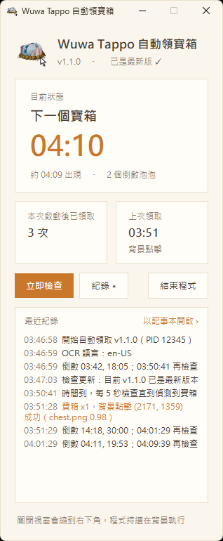

# Auto_WuwaTappo


自動領取 **Wuwa Tappo** 桌寵的寶箱（約每 30 分鐘一次）。開著放背景就好，
不會移動你的滑鼠，玩全螢幕遊戲時也照常領取。

> 非官方工具，與 Kuro Games 無關。

<p align="center">
  
</p>

## 特色
- **全自動**：讀取桌寵泡泡上的倒數，時間到就自動領寶箱，不用一直盯著
- **不干擾操作**：用背景點擊領取，不移動滑鼠、不搶視窗焦點
- **玩遊戲也能領**：桌寵被全螢幕遊戲或其他視窗蓋住仍能偵測（單螢幕也可以）
- **狀態一目了然**：米白色小視窗顯示下一個寶箱倒數、已領次數、最近紀錄
- **常駐右下角**：關掉視窗會縮到系統匣，雙擊圖示再叫出來
- **更新提示**：自動檢查新版本；直接開啟新版會自動關掉舊版

## 下載與使用
1. 到 [Releases](../../releases/latest) 下載 `AutoWuwaTappo.exe`，放在任意資料夾。
2. 先開啟 Wuwa Tappo 桌寵，再執行 `AutoWuwaTappo.exe`。
3. 跳出 UAC 時按「是」（原因見[常見問題](#常見問題)）。
4. 狀態視窗出現就代表開始運作了。之後關掉視窗也沒關係，程式會繼續在右下角執行。

### 狀態視窗
| 區塊 | 說明 |
|---|---|
| 標題列下方 | 目前版本；點「檢查更新」立即檢查，有新版會變成「下載新版 vX ›」 |
| 目前狀態 | 下一個寶箱的倒數與預計出現時間；或「時間到，等待寶箱出現」、「找不到桌寵」等狀態 |
| 本次啟動後已領取 | 這次開啟程式後領到幾個寶箱 |
| 上次領取 | 最近一次領到的時間，以及用哪種方式（背景點擊／滑鼠點擊） |
| 立即檢查 | 不等倒數，馬上檢查一次 |
| 紀錄 ▾ | 展開最近紀錄；領到寶箱的紀錄以橘色、錯誤以紅色標示。可「以記事本開啟」完整紀錄 |
| 結束程式 | 完全關閉（關掉視窗右上角的 ✕ 只會縮到右下角） |

### 系統匣（右下角）圖示
- **雙擊**：開啟狀態視窗
- **滑鼠停留**：顯示目前狀態
- **右鍵**：開啟視窗、立即檢查、開啟紀錄、檢查更新、結束

### 更新
程式每天會自動檢查一次 GitHub 有沒有新版，有的話跳出通知，視窗上也會出現下載連結（不會自動下載）。
下載新版後**直接執行就好**，不用先關舊版：新版會自動關閉正在執行的舊版再接手。

紀錄檔在 exe 旁的 `logs\auto_tappo.log`。

## 常見問題

**為什麼需要系統管理員權限（UAC）？**
Wuwa Tappo 本身是以系統管理員權限執行的，Windows（UIPI）會擋掉一般權限程式送給它的點擊，
所以本程式也必須以系統管理員執行。

**Windows 顯示「Windows 已保護您的電腦」或防毒軟體擋下？**
exe 沒有數位簽章，又會模擬點擊，容易被誤判。可以按「其他資訊 → 仍要執行」；
不放心的話可以看原始碼自己打包（見[開發](#開發)）。

**一直顯示「找不到桌寵」或「沒看到泡泡」？**
確認 Wuwa Tappo 桌寵有開著、沒有被隱藏或最小化。可以按「立即檢查」，再展開「紀錄」看詳細訊息。

**玩遊戲時會不會影響遊戲？**
領取時用的是背景點擊，直接把點擊送給桌寵，不會移動滑鼠、也不會切換視窗。
萬一背景點擊無效、需要改用滑鼠點擊時，若前景是全螢幕遊戲就會先等，離開遊戲後才點。

**寶箱沒有被領？**
展開「紀錄」看最近的訊息。若桌寵改版導致寶箱外觀改變，模板可能需要更新（見[換寶箱模板](#換寶箱模板)）。

## 運作方式
1. **截圖**：用 Windows Graphics Capture 只截桌寵視窗本身，被其他視窗或全螢幕遊戲蓋住也截得到，
   也不會誤認 Discord 等其他視窗裡的 Tappo 圖片。無法使用時才改截螢幕上的該範圍。
2. **找泡泡**：用底色找出桌寵旁的泡泡框。
3. **寶箱** → 模板比對（`templates/chest.png`，依泡泡大小自動縮放）後點擊領取：
   優先用背景點擊（把點擊訊息送進桌寵的 WebView 視窗）；連續無效才改用移動滑鼠點擊，
   此時若前景是全螢幕程式、滑鼠被遊戲鎖住，或寶箱被其他視窗擋住，就暫緩點擊。
4. **倒數（mm:ss）** → 用 Windows 內建 OCR 讀時間，睡到最短的倒數結束再檢查；
   最多 10 分鐘會重新確認一次，防止桌寵被移動或 OCR 讀錯。
5. **時間到** → 每 5 秒檢查一次，直到偵測到寶箱並領取。

支援多螢幕、不同螢幕縮放比例與桌寵大小（以縮放截圖模擬測過桌寵 50%～200%）。

### 已知限制
- 桌寵 50% 且螢幕縮放 100% 時，倒數字太小讀不到，會改為每 30 秒檢查一次寶箱。
- Windows 10 舊版本截圖時可能會短暫出現黃色邊框（Windows 11 不會）。
- 桌寵最小化或隱藏時無法偵測。

## 專案結構
```
auto_tappo.py        核心：截圖、偵測泡泡、OCR 倒數、點擊；也可單獨用命令列執行
tray_app.py          系統匣 App（打包成 exe 的進入點；更新檢查、接手舊版）
ui.py                狀態視窗（tkinter，米白色系）
templates/chest.png  寶箱模板（比對時依泡泡大小自動縮放）
assets/              App 圖示（icon.png / icon.ico）
docs/                README 用的截圖
tools/make_icon.py   由 logo 圖產生圖示：去背＋加滑鼠游標（logo 原圖不在 repo）
build.bat            用 PyInstaller 打包成 dist\AutoWuwaTappo.exe
```

## 開發
需求：Windows 10（1903 以上）/ 11、Python 3.10+。OCR 優先用英文，沒有就用系統語言（如繁中）。
```
pip install -r requirements.txt
python tray_app.py            # 視窗＋系統匣版（會要求系統管理員權限）
python tray_app.py --selftest # 掃一次寫入紀錄，確認偵測正常（不需管理員）
build.bat                     # 打包 exe（另需 pip install pyinstaller）
```
版本號在 `auto_tappo.py` 的 `VERSION`；發布時 GitHub Release 的 tag 要用 `v` + 版本號（例如 `v1.1.0`），
程式的更新檢查會以此比對。

### 命令列版本
```
python auto_tappo.py          # 背景執行（無視窗）
python auto_tappo.py status   # 是否在執行＋最近紀錄
python auto_tappo.py stop     # 停止
python auto_tappo.py --console  # 在可見的命令列視窗執行
python auto_tappo.py scan     # 掃一次，印出目前的寶箱與倒數（除錯用）
python auto_tappo.py snap     # 截桌寵視窗到 snaps/
python auto_tappo.py --dry    # 只偵測不點擊
```

| 參數 | 預設 | 說明 |
|---|---|---|
| `--max-wait` | 600 | 倒數時最多睡幾秒就重新確認 |
| `--poll` | 5 | 倒數結束後的檢查間隔（秒），直到偵測到寶箱 |
| `--interval` | 30 | 找不到視窗或泡泡時的重試間隔（秒） |
| `--threshold` | 0.85 | 寶箱比對門檻 |
| `--dry` | | 只偵測不點擊 |
| `--no-elevate` | | 不自動要求系統管理員權限 |
| `--console` | | 不隱藏，在命令列視窗執行 |

同時只會有一份在執行（視窗版與命令列版共用）。

### 換寶箱模板
寶箱外觀改變時：等寶箱出現時 `python auto_tappo.py snap`，把寶箱圖示（只裁圖示本體）
存成 PNG 放進 `templates/`，並把 `auto_tappo.py` 的 `CHEST_BUBBLE_H`、`CHEST_BUBBLE_W` 改成截圖時寶箱泡泡框的高、寬（像素），
程式會以此為基準依實際泡泡大小縮放模板。

## 授權
[MIT License](LICENSE)
